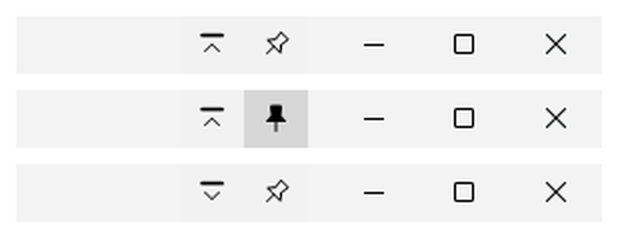
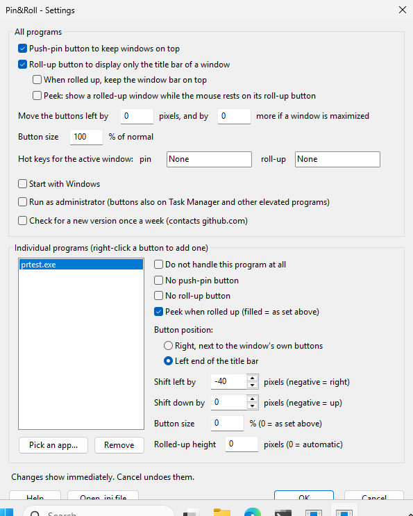

# Pin&Roll

Two extra buttons in the title bar of your windows on Windows 10 and 11:

| Button | What it does |
|---|---|
| **Push-pin** | Keeps the window above all other windows ("always on top"). Click again to release it. |
| **Roll-up** | Shrinks the window to its title bar so you can see what is behind it. Click again to roll it back down. |

Pin&Roll is one small program (`pr.exe`, no installer) that sits in the
notification area. It changes nothing inside other programs: it only draws
its two buttons on top of their title bars.

## Download

Get `pr.exe` from the [Releases](../../releases/latest) page. If there is no
release yet, open the newest successful run under [Actions](../../actions) and
download the `pinroll-windows-2025` artifact (this needs a GitHub login).

### The program is not signed

Pin&Roll is free, open-source software built by GitHub from the source in
this repository. It has no paid code-signing certificate, so:

- your browser may block or warn about the download: choose to keep the file;
- Windows may show *"Windows protected your PC"* on first start: click
  **More info**, then **Run anyway**;
- antivirus software may be cautious, because a program that draws over other
  windows and moves them is unusual.

If you would rather not trust a download, build it yourself (see
[Build](#build)); it takes two commands.

## Use

Run `pr.exe`. A blue pin icon appears near the clock (possibly under the
**^** arrow).

- **Click** a title bar button to pin or roll up that window. This also works
  on windows that are not active.
- **Right-click** a button for *Customize \<program\>...*, *Settings...* and
  *Help*.
- **Double-click** the tray icon for the settings; click it for the menu,
  including *Help* and *Exit*.

The built-in **Help** page explains every setting.

### Settings in brief

For all programs: show or hide each button, keep rolled-up windows on top,
*peek*, a global shift and button size, hot keys, *Start with Windows* and
*Run as administrator*.

For individual programs (add one with *Pick an app...* or by right-clicking a
button): ignore the program, keep only one button, put the buttons on the
right or at the left end of the title bar, shift them sideways and
vertically, resize them, and set the rolled-up height.

Changes apply while you make them. Everything is stored in
`%APPDATA%\PinRoll\pinroll.ini`. *Open .ini file* in the settings window
opens it; hand edits and your own comment lines are kept, and changes are
picked up when you save the file.

### Updates and privacy

Pin&Roll does not use the internet unless you ask it to: *Check for updates*
in the tray menu, or the optional weekly check in the settings (off by
default), asks github.com which release is the latest. Nothing is downloaded
or installed automatically, and no information about you is sent beyond what
any visit to a web site reveals (your internet address).

### How it behaves

- A rolled-up window keeps its position and width and can be dragged.
- Maximizing a rolled-up window shows it in full; restoring it brings the
  strip back.
- Resizing a rolled-up window by its top or bottom edge ends the rolled state.
- The buttons hide while a window is dragged and return when you let go.
- *Peek* (off by default): rest the mouse on the roll-up button of a
  rolled-up window and it opens; it rolls up again when the mouse leaves the
  title bar.
- The pin always shows the window's real state, also when another tool pinned
  it.
- Exiting, or switching the roll-up button off, unrolls every window. If
  Pin&Roll is closed unexpectedly, rolled-up windows are recognised again on
  the next start.

## Known limits

- **Programs running as administrator** (Task Manager, for example) get
  buttons only if Pin&Roll runs as administrator too; Windows blocks it
  otherwise. Use the *Run as administrator* setting.
- **Programs that draw their own title bar** (browsers, Electron and WinUI
  apps) are asked where their real buttons and the nearest free stretch of
  title bar are. Where that fails or the title bar is crowded, the buttons can
  cover one of the program's own controls; give that program its own
  position, shift or size in the settings.
- While a rolled-up window is being dragged, some programs make it taller for
  the duration of the drag. It returns to a strip when released.
- Full-screen windows get no buttons.
- There are no "Always on top" / "Roll up" entries in the window's system
  menu. Hot keys can be set instead.

## Status

Used daily by its author on Windows 11, with two monitors at different
scaling. An automated test drives the buttons on real windows with real mouse
input and runs on Windows Server 2025 and 2022 for every change
(`.github/workflows/build.yml`). Windows 10 itself has not been tried by a
person.

## Build

With Visual Studio 2022 (C++ workload) and CMake:

    cmake -B build -A x64
    cmake --build build --config Release

The program is `build\Release\pr.exe`. To run the test:

    build\Release\prtest.exe build\Release\pr.exe

`build-mingw.sh` cross-compiles on Linux with mingw-w64.

## How it works

Pin&Roll injects nothing into other programs. One process:

- listens to window events (`SetWinEventHook`, out of process);
- asks the desktop compositor where the minimize / maximize / close buttons
  are (`DWMWA_CAPTION_BUTTON_BOUNDS`, `DWMWA_EXTENDED_FRAME_BOUNDS`), and for
  self-drawn title bars asks the window itself by hit-testing;
- keeps a small layered window with the two buttons directly above each
  window in the Z order;
- rolls a window up by resizing it to its title bar height.

Because it works from outside, it treats 32-bit, 64-bit and ARM64 programs
alike.

## Background, credits and licence

Developed by Alex Potemkin, ShotPorter. See [more from this developer](MORE.md).

Pin&Roll started as a refresh of two functions of **FileBox eXtender** v2.01,
(C) 1999-2011 Greg Kochaniak, Hyperionics Technology LLC, released under the
GPL. FileBox eXtender added its buttons by injecting a DLL into every
program, which no longer works for many windows on current Windows. Its
other functions (Favorites and Recent folders in file dialogs, dialog
resizing, Explorer integration) are intentionally left out.

The behaviour of the two buttons follows the original closely, with these
differences: a pin set while a window is rolled up is kept after unrolling;
resizing is not blocked while rolled up; and the buttons are flat glyphs that
take a light or dark colour from the title bar behind them.

The roll-up technique without injection follows AltSnap; window tracking
follows the approach of Microsoft PowerToys "Always On Top". No code was
copied from either, or from FileBox eXtender.

GNU General Public License v3 or later, see `LICENSE`.
